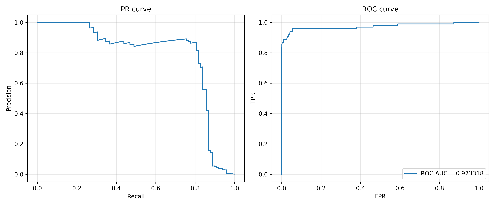

# Лабораторна робота №2: Поріг рішення під асиметричну ціну помилок


**Стек:** Python 3.12, NumPy, pandas, scikit-learn, PyTorch, Matplotlib  

**Набір даних:** [Credit Card Fraud Detection (Kaggle)](https://www.kaggle.com/datasets/mlg-ulb/creditcardfraud)


---
## Команди для запуску програми
Усі команди мають виконуватися в теці `lab2`
### Ініціалізація

```bash
uv venv
uv pip install -r requirements.txt
uv run python -c "import urllib.request, zipfile; urllib.request.urlretrieve('https://www.kaggle.com/api/v1/datasets/download/mlg-ulb/creditcardfraud', 'data.zip'); zipfile.ZipFile('data.zip').extractall('.')"

```


### Навчання моделі та збереження прогнозів
(За наявності файлів `results/predictions.npz` та `results/split_summary.csv` це можна пропустити)

```bash
uv run python lab2_starter.py --data creditcard.csv --out results

```


### Інформація про розподіл вибірки зі збережених прогнозів (без навчання)
(При виконанні навчання виводяться ці ж самі результати) 
```bash
uv run python lab2_starter.py --saved results
```


### Запуск аналізу результатів
```bash
uv run python lab2_main.py
```

---
## 1. Поділ вибірки та попередня обробка

Використовується датасет **Credit Card Fraud Detection**, що містить 284,807 транзакцій, з яких 492 є шахрайськими (`Class = 1`). Для навчання використовуються 29 ознак (`V1–V28` та `Amount`). Ознака `Time` виключена з обробки.


### Поділ вибірки (60% / 20% / 20%)


1. Початковий порядок рядків CSV збережено через індекси `row_id`.

2. Виконано стратифікований поділ `train_test_split` ($60\%$ train, $40\%$ остача, `random_state=0`, `stratify=y`).

3. Остачу поділено навпіл ($20\%$ validation, $20\%$ test, `random_state=0`, `stratify=y_tmp`).


| Підвибірка | Кількість об'єктів | Кількість шахрайств | Частка шахрайських транзакцій |
| :--- | :---: | :---: | :---: |
| Train | 170 884 | 295 | 0.001726 |
| Validation | 56 961 | 98 | 0.001720 |
| Test | 56 962 | 99 | 0.001738 |


**Чому статистики стандартизації не можна обчислювати на всьому наборі даних?**  

Обчислення середнього та стандартного відхилення на всьому датасеті призводить до витоку даних з валідаційної та тестової вибірок у навчальну.
Це впливає на результати і робить їх кращими при перевірці, оскільки сенс навчання це з відомих даних отримати 
інформацію про ненаявні наразі, їх треба обчислювати лише на навчальній вибірці.


---


## 2. Математичні формули метрик


### Метрики та Функція вартості


Для обраного порога $t$ транзакція класифікується як шахрайська, якщо $s_i \ge t$.


- **TP:** $y_i = 1 \land s_i \ge t$

- **FP:** $y_i = 0 \land s_i \ge t$

- **FN:** $y_i = 1 \land s_i < t$

- **TN:** $y_i = 0 \land s_i < t$


Функція вартості помилок:


$$C(t) = 10 \cdot \text{FN}(t) + \text{FP}(t)$$


Додаткові метрики:


$$\text{Precision} = \frac{\text{TP}}{\text{TP} + \text{FP}}, \quad \text{Recall}=\text{TPR} = \frac{\text{TP}}{\text{TP} + \text{FN}}, \quad\text{FPR} = \frac{\text{FP}}{\text{FP + TN}}$$


### Оцінка кривих на Validation
**ROC-AUC:** 0.973318

<p align="center">
  
</p>


### Чому висока ROC-AUC не гарантує малої вартості помилок чи високої точності?
Тому що ROC-AUC оцінює ранжування транзакцій за всіма порогами, а вартість і precision — результат рішення при конкретному порозі.

Крім того, ROC-AUC не враховує задану ціну помилок і співвідношення класів. При рідкісному шахрайстві, а тобто в загальному при дисбалансі класів, навіть малий FPR (FP << TN) може дати більше хибних тривог, ніж справжніх, (FP > TP) тому precision буде низьким.

---

## 3.  Швидкий алгоритм пошуку порога $O(N \log N)$


1. Згруповуємо об'єкти за унікальними оцінками $s_i$ та підраховуємо суму позитивних ($y=1$) і негативних ($y=0$) міток, та сумуємо значення всередині груп.

2. Сортуємо унікальні оцінки за спаданням.

3. Обчислюємо кумулятивні суми (`cumsum`) від найбільшої оцінки до найменшої:

   - На кроці $k$ кумулятивна сума позитивних прикладів дає $\text{TP}(t_k)$.

   - Кумулятивна сума негативних прикладів дає $\text{FP}(t_k)$.

4. Обчислюємо $\text{FN}(t_k) = N_{\text{pos}} - \text{TP}(t_k)$ та $\text{TN}(t_k) = N_{\text{neg}} - \text{FP}(t_k)$.

5. Додаємо крайній поріг $t = +\infty$ ($\text{TP}=0, \text{FP}=0, \text{FN}=N_{\text{pos}}, \text{TN}=N_{\text{neg}}$).

6. Знаходимо мінімум $C(t)$. Якщо мінімум досягається на кількох порогах, обирається найбільший (перший) з них і позначається як $t^*$.


### Результати на валідаційній вибірці (Validation)


За допомогою швидкого алгоритму знайдено оптимальний поріг $t^*$ = 0.03119390830397606.


| Правило| Поріг | TP | FP | FN | TN | C |
| :---: | :---: | :---: | :---: | :---: | :---: | :---: |
| "Стандартний" поріг | 0.5 | 71 | 9 | 27 | 56 854 | 279 |
| $t^*$ | 0.031194 | 82 | 34 | 16 | 56 829 | 194 |
| Усі негативні | $+\infty$ | 0 | 0 | 98 | 56 863 | 980 |

Повну таблицю кандидатів збережено у файлі `results/threshold_candidates.csv`


---


## 4. Перевірка алгоритму на тестових наборах (A, B, C)


Для перевірки швидкого алгоритму $O(N \log N)$ його результати порівнювалися з прямим перебором $O(N^2)$ на контрольних наборах **A**, **B**, **C**.


| Набір | Оцінки s | Мітки y |
|-------|----------|---------|
| A  | [0.9; 0.7; 0.7; 0.4; 0.2; 0.1] | [0; 1; 0; 1; 0; 0] |
| B  | [0.9; 0.6; 0.3] | [0; 0; 0] |
| C | [0.8; 0.5 (×11); 0.2] | [1; 1; 0 (×10); 0] |

- Набір А перевіряє коректність обробки ситуацій, коли декілька об'єктів мають однакові оцінки, але належать до різних класів. Такі об'єкти мають об'єднуватися оскільки завжди отримуватимуть однаковий прогноз відносно порогу.   

- Набір Б перевіряє граничний випадок без позитивних міток класу, і показує цим важливість додавання $+\infty$.

- Набір С перевіряє правило нічиєї, коли при однаковому С має обиратися більший поріг. Це відповідає зменшенню хибних блокувань.

**Набір A**

| Поріг | TP | FP | FN | TN | C |
|-----------|----|----|----|----|----|
| $+\infty$ | 0 | 0 | 2 | 4 | 20 |
| 0.9 | 0 | 1 | 2 | 3 | 21 |
| 0.7 | 1 | 2 | 1 | 2 | 12 |
| **0.4** | **2** | **2** | **0** | **2** | **2** |
| 0.2 | 2 | 3 | 0 | 1 | 3 |
| 0.1 | 2 | 4 | 0 | 0 | 4 |

$t^*_1=t^*_2 = 0.4000000059604645$

Таблиці збігаються за обома алгоритмами.

**Набір B**

| Поріг | TP | FP | FN | TN | C |
|-----------|----|----|----|----|----|
| **$+\infty$** | **0** | **0** | **0** | **3** | **0** |
| 0.9 | 0 | 1 | 0 | 2 | 1 |
| 0.6 | 0 | 2 | 0 | 1 | 2 |
| 0.3 | 0 | 3 | 0 | 0 | 3 |

$t^*_1=t^*_2 = +\infty$

Таблиці збігаються за обома алгоритмами.

**Набір C**

| Поріг | TP | FP | FN | TN | C |
|-----------|----|----|----|----|----|
| $+\infty$ | 0 | 0 | 2 | 11 | 20 |
| **0.8** | **1** | **0** | **1** | **11** | **10** |
| 0.5 | 2 | 10 | 0 | 1 | 10 |
| 0.2 | 2 | 11 | 0 | 0 | 11 |

$t^*_1=t^*_2 = 0.800000011920929$

Таблиці збігаються за обома алгоритмами.

**Таблиці порівнювалися через `pandas.testing.assert_frame_equal` з `check_exact=True`.**

---


## 5. Тестова оцінка (Test) та аналіз помилок


Фіксований поріг $t^*$, знайдений на Validation, застосовано до тестової вибірки.


### Метрики для $t^* = 0.03119390830397606$


| Правило | Поріг | TP | FP | FN | TN | Вартість $C$ | Precision | Recall |
|:------: | :---: | :---: | :---: | :---: | :---: | :---: |:---: | :---: |
| "Стандартний" поріг | 0.500000 | 71 | 8 | 28 | 56855 | 288 | 0.898734 | 0.717172 |
| $t^*$ | 0.031194 | 80 | 43 | 19 | 56820 | 233 | 0.650407 | 0.808081 |
            


**Якщо знаменник нульовий, метрика (recall, precision) не визначена - поясніть чому.** 

Бо вони відповідають на питання яка частка з "усіх ..." є "...". За відсутності "усіх ..." оцінити частку неможливо та і вона не має сенсу. Наприклад, Precision відповідає за яка частка з усіх позначених як шахрайство системою випадків є справді випадком шахрайства. Якщо система не позначила жоден випадок як шахрайство, така метрика втрачає користь. 


### Аналіз перших 5 FP та FN прикладів
| Рядок | Тип | Мітка | Оцінка | Відстань до $t^*$ | Amount |
|--------|------------|-------|-------|-----------------------|--------|
| 460 | FP | 0 | 0.196159 | 0.164965 | 2.00 |
| 2961 | FP | 0 | 0.080961 | 0.049767 | 2.49 |
| 10783 | FP | 0 | 0.966327 | 0.935133 | 89.99 |
| 13405 | FP | 0 | 0.932032 | 0.900838 | 89.99 |
| 13617 | FP | 0 | 0.922762 | 0.891568 | 89.99 |
| 10497 | FN | 1 | 0.011464 | 0.019730 | 3.79 |
| 52521 | FN | 1 | 0.006373 | 0.024821 | 105.99 |
| 55401 | FN | 1 | 0.005642 | 0.025552 | 1.00 |
| 91671 | FN | 1 | 0.000500 | 0.030693 | 290.18 |
| 93486 | FN | 1 | 0.018352 | 0.012842 | 0.00 |


- **Amount:** чіткого розділення між FP і FN немає. І там, і там є дрібні суми (до 4) та великі (90 і більше), а три FP мають однакову суму 89.99.
- **Відстань до $t^*$:** у FN вона мала (0.013 до 0.031), у FP велика (до 0.935). Це здебільшого наслідок низького порога $t^* \approx 0.031$, бо оцінка не може бути менше за 0, тож FN не можуть бути далеко, а FP можуть.
- **Висновок:** за 10 прикладами причину помилок визначити не можна. Вибірка не випадкова (перші за `row_id`), замало даних, немає порівняння з TP/TN.


---


## 6. Висновки

**Що змінив вибір порога.** 

Оптимальним порогом був той, який мінімізує $C(t) = 10 \cdot \text{FN} + \text{FP}$ на validation. Оскільки пропущене шахрайство коштує вдесятеро більше за хибну тривогу, оптимальний поріг сильно зсунувся вниз. Для незмінної моделі це означає перехід від режиму симетричної мінімізації загальної кількості помилок у режим, адаптований під мінімізацію вартості $C(t)$.

**Ціна цього рішення в термінах FP і FN.**

| Вибірка | Поріг | FN | FP | $C$ |
|:---:|:---:|:---:|:---:|:---:|
| Validation | 0.5 | 27 | 9 | 279 |
| Validation | $t^*$ | 16 | 34 | 194 |
| Test | 0.5 | 28 | 8 | 288 |
| Test | $t^*$ | 19 | 43 | 233 |

- На validation FN зменшилось на 11 (виграш $11 \cdot 10 = 110$), FP зросло на 25 (втрата 25), тож $C$ впала на 85 (≈ 30%).
- На test FN зменшилось на 9 (виграш 90), FP зросло на 35 (втрата 35), тож $C$ впала на 55 (≈ 19%).
- Recall зріс з 0.717 до 0.808, але precision впала з 0.899 до 0.650: приблизно кожна третя тривога тепер хибна. Це свідомий обмін, який окупається лише через асиметричну ціну помилок.

**Чому виграш на validation не гарантує такого самого на test.**

1. **Оптимістична оцінка.** $t^*$ обрано як мінімум $C$ саме на validation, тому $C = 194$ це найкраща можлива вартість для цієї вибірки, а не незалежна оцінка. На нових даних поріг уже не підігнаний, тож вартість зазвичай гірша.
2. **Мала кількість позитивів.** У validation лише 98 шахрайств, у test 99. Кожен FN коштує 10, тому зсув усього на кілька об'єктів змінює $C$ на десятки одиниць. Різниця між 85 і 55 є прикладом такої випадкової розбіжності.

---
## Використання генеративного штучного інтелекту

Gemini 3.6 Flash був використаний для створення загальної структури звіту, далі Claude Sonnet 5.5 використовувався для форматування таблиць та формул, а також для написання певних висновків до завдань 
з подальшим переглядом та за потреби редагуванням. Для коду використовувався Claude Sonnet 5.5 лише з метою оформлення виводів, а саме: графіки, результати в консолі та збереження у html. 


