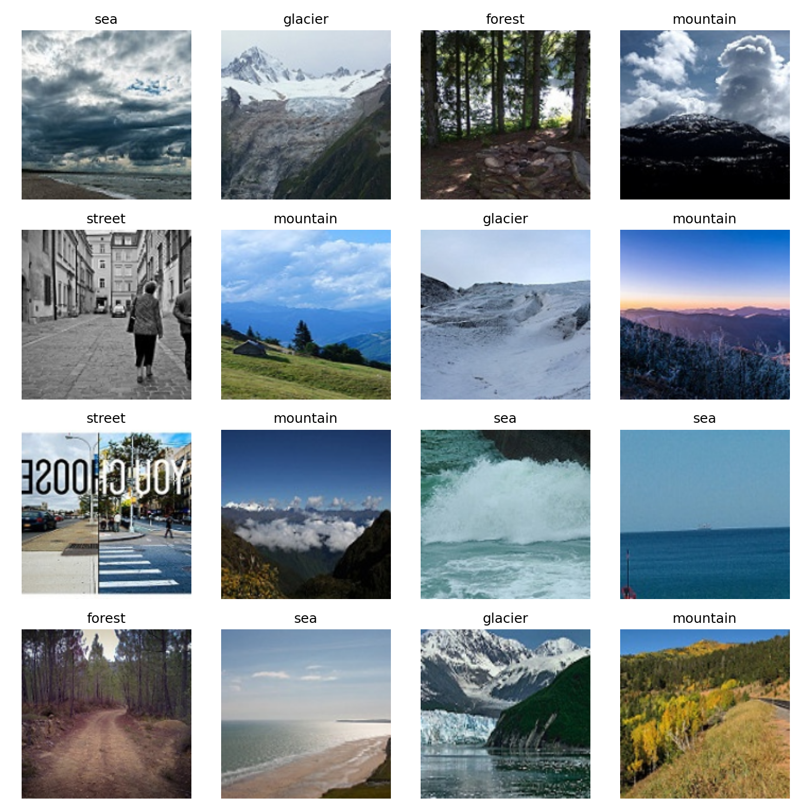
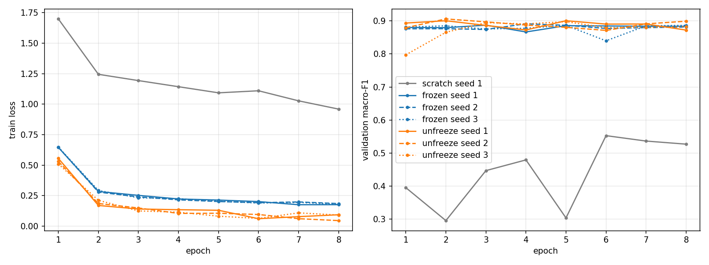
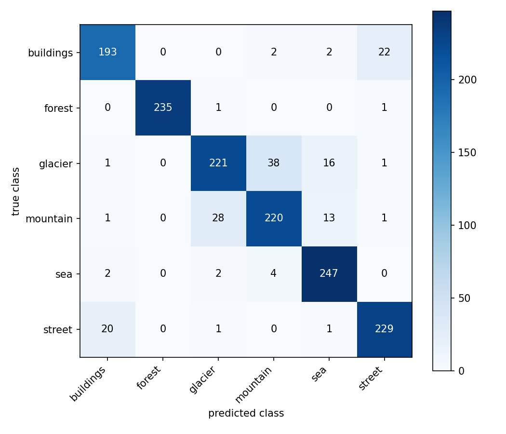
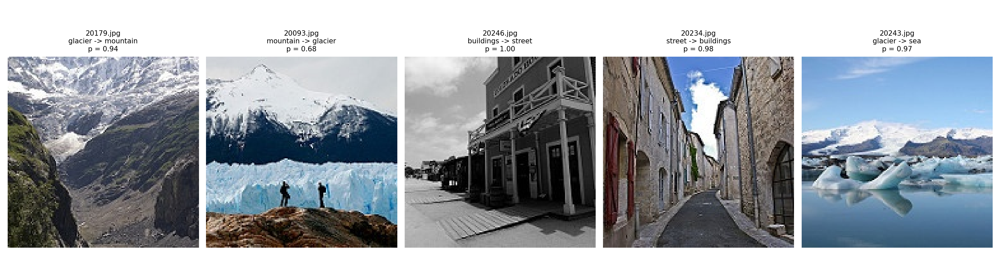

# ЛР3. Обчислювальний експеримент і трансферне навчання

## Запуск

Усі команди мають виконуватися в теці проекту `/lab3`. Перед початком треба завантажити набір даних 
[Intel Image Classification](https://www.kaggle.com/datasets/puneet6060/intel-image-classification). Для команд запуску припустимо, що набір лежить в теці `/lab3/dataset`.
Тоді команди запуску будуть такі:
```bash
uv sync
uv run lab3-train   --data dataset     # навчання
uv run lab3-analyze --data dataset     # аналіз і test
```
Що ці комнади робитимуть:


`lab3-train` будує `split.csv` і перевіряє його за контрольною таблицею, виконує перевірки пунктів 1–2, навчає сім запусків, вибирає конфігурацію за validation і зберігає `lab3_model.pt`. Test він не відкриває. Якщо поділ або перевірки режимів не збігаються з очікуваним, команда зупиняється з помилкою.

`lab3-analyze` перевіряє, що хеш `split.csv` однаковий у всіх семи журналах і збігається з поточним, будує таблицю, криві та ефекти зі збережених журналів, перевіряє, що `lab3_model.pt` відповідає правилу вибору, один раз оцінює цю модель на test на CPU і будує матрицю плутанини та п'ять помилок. Навчання тут немає, ваги окремих запусків не потрібні, лише `lab3_model.pt`.

### Додаткові прапорці `lab3-train`

| Прапорець | Типове значення | Що робить |
|---|---|---|
| `--data` | треба вписати вручну | Тека, де лежать `seg_train/` і `seg_test/` |
| `--out` | `results` | Куди пишуться `split.csv`, `split_summary.csv` і `checks/` (рисунок пакета, початкова втрата, таблиці перевірок) |
| `--runs` | `runs` | Куди пишуться запуски: `runs/<режим>_seed<зерно>/` з `run.json`, `val_logits.npy` і `model.pt` |
| `--model` | `lab3_model.pt` | Куди зберігається вибраний запуск (ключі `state_dict`, `regime`, `seed`, `classes`, `img_size`) |
| `--force` | `вимкнено` | Навчає всі сім запусків заново. Без нього запуск, для якого вже є `run.json` і `model.pt` з тим самим хешем `split.csv`, пропускається. Пропуск не бачить змін у коді, тому після зміни коду або формату журналу потрібен `--force` |

### Прапорці `lab3-analyze`

| Прапорець | Типове значення | Що робить |
|---|---|---|
| `--data` | треба вписати вручну | Тека з `seg_test/`; звідси читаються зображення test |
| `--out` | `results` | Звідки береться `split.csv` (той самий `--out`, що в навчанні); результати пишуться в `<out>/analysis/` |
| `--runs` | `runs` | Звідки читаються журнали `run.json` усіх семи запусків |
| `--model` | `lab3_model.pt` | Модель для оцінки на test; перед цим перевіряється, що вона збігається з вибором за журналами |

## Структура

| Файл | Що в ньому |
|---|---|
| `pyproject.toml`, `uv.lock` | Залежності з фіксованими версіями (Python 3.12, torch 2.8.0, torchvision 0.23.0 та ін.) |
| `src/config.py` | Константи: класи, mean/std, розмір 160, гіперпараметри, режими й модулі в `eval()` |
| `src/data.py` | Поділ, контрольна таблиця, датасет, перетворення, завантажувачі |
| `src/net.py` | Побудова моделі, `set_train_mode`, оптимізатор із групами |
| `src/checks.py` | Перевірки пунктів 1–2: поділ, рисунок пакета, L₀, параметри, що змінюється за 5 кроків, дослід із BN |
| `src/runs.py` | Журнали запусків (`run.json`), правило вибору режиму й запуску за validation |
| `src/tables.py` | Читання й запис CSV |
| `src/train.py` | Команда навчання (`lab3-train`) |
| `src/analysis.py` | Команда аналізу (`lab3-analyze`); test відкривається тільки тут |
| `results/split.csv` | Поділ: `file`, `label`, `part` |
| `results/split_summary.csv` | Контрольна таблиця; стовпець `match` = yes у всіх рядках |
| `results/checks/` | Звіти перевірок пунктів 1–2 (`params.csv`, `changes.csv`, `bn_layer1_0_bn1.csv`), `batch.png` |
| `results/analysis/` | Результати аналізу: `runs_table.csv`, `curves.png`, `selection.csv`, `test_summary.csv`, `confusion_matrix.png`, `errors.csv`, `errors.png` |
| `runs/` | Для кожного з семи запусків `run.json` і `val_logits.npy` (1498 × 6); `model.pt` лише локально |
| `lab3_model.pt` | Ваги вибраного запуску |

## Дані та поділ

Процедура з умови:

1. Для кожного класу — `sorted()` імен файлів з його теки (рядковий порядок, як у `ImageFolder`): `0.jpg, 10006.jpg, 1001.jpg, …`.
2. **train**: один `np.random.default_rng(0)` на всі класи у фіксованому порядку. `idx = np.arange(n_k); rng.shuffle(idx)`; у train ідуть файли `idx[:200]` відсортованого списку → 1 200 зображень.
3. **validation + test**: новий `np.random.default_rng(0)`, той самий прохід по класах у `seg_test`. `cut = n_k // 2`; `idx[:cut]` → validation, `idx[cut:]` → test.

Зображення відкриваються через Pillow з `.convert("RGB")`; усі перетворення приводять їх до 160×160, тож 55 зображень, менших за висотою, не відкидаються.

## Теорія та формули

### 1. BN і ковзні статистики

`BatchNorm2d` зберігає буфери `running_mean`, `running_var`, `num_batches_tracked` і параметри `γ, β`. У режимі `train()` під час прямого проходу нормування йде за статистиками поточного пакета, а ковзні статистики оновлюються експоненціальним згладжуванням:

$$
r \leftarrow (1 - m)\,r \;+\; m\,b, \qquad m = 0{,}1,\ b = \text{batch stat}.
$$

У режимі `eval()` BN буфери не оновлює і нормує за `running_*`. Прапор `training`, яким керують `.train()`/`.eval()`, не залежить від `requires_grad`: буфери — не параметри. Тому у заморожених шарах одного `requires_grad=False` недостатньо; `set_train_mode` робить `model.train()`, а потім `.eval()` для модулів зі стовпця «У eval()» таблиці режимів.

### 2. Дискримінативні швидкості навчання

У `unfreeze` голова `fc` вчиться з `lr = 3·10⁻³`, а `layer4` — з `lr = 3·10⁻⁴`. `fc` ініціалізований випадково й потребує великих кроків; `layer4` уже має корисні ознаки з ImageNet, і за великої швидкості навчання на 1200 зображеннях перші кроки AdamW можуть зіпсувати їх, перш ніж `fc` встигне навчитися. Це стандартне міркування, окремим експериментом воно не перевірялося.

### 3. macro-F1 і ефекти

$$
\text{F1}_k = \frac{2\,TP_k}{2\,TP_k + FP_k + FN_k}, \qquad \text{macro-F1} = \frac{1}{6}\sum_{k=0}^{5}\text{F1}_k.
$$

$F_{r,s}$ — macro-F1 на validation після 8-ї епохи для режиму $`r`$ і зерна $`s`$.

$$
\bar F_r = \tfrac{1}{3}\sum_{s=1}^{3} F_{r,s}, \qquad R_r = \max_s F_{r,s} - \min_s F_{r,s}, \qquad R = \max(R_{\text{frozen}}, R_{\text{unfreeze}}).
$$

$$
\Delta_{\text{pre}} = \bar F_{\text{frozen}} - F_{\text{scratch},1}, \qquad
\Delta_{\text{unf}} = \bar F_{\text{unfreeze}} - \bar F_{\text{frozen}}, \qquad
\Delta_{\text{pre}} + \Delta_{\text{unf}} = \bar F_{\text{unfreeze}} - F_{\text{scratch},1}.
$$

**Правило інтерпретації** (окремо для $\Delta_{\text{pre}}$ і $\Delta_{\text{unf}}$):
- $|\Delta| \le R$ — різниця не відрізняється від розкиду, результату немає;
- $|\Delta| > R$ — ефект вартий перевірки, але не доведений.

Нехай $F_{r,s}$ за різних зерен мають стандартне відхилення $\sigma$. Тоді $E[R_r] \approx 1{,}69\,\sigma$, стандартна похибка різниці двох середніх із трьох запусків $\approx 0{,}82\,\sigma$, а $\text{SD}(R_r) \approx 0{,}89\,\sigma$. Правило $|\Delta| > R$ в середньому вимагає різниці понад дві стандартні похибки, тобто воно консервативне; водночас розмах трьох значень дуже неточний, тож це груба оцінка шуму, а не довірчий інтервал.

### 4. Стандартна похибка частки на test

Для accuracy $p$ на $n$ незалежних прикладах:

$$
\text{SE}(p) = \sqrt{\dfrac{p\,(1-p)}{n}}.
$$

## Пункт 1. Перевірки до навчання

### 1.1 Поділ

Усі 18 клітинок і три підсумкові рядки збіглися з контрольною таблицею (`results/split_summary.csv`, стовпець `match` = yes скрізь). Кожна клітинка — «кількість / сума числових імен файлів» (`20057.jpg → 20057`):

| Клас | train | validation | test |
|---|---|---|---|
| `buildings` | 200 / 1 996 761 ✓ | 218 / 4 837 323 ✓ | 219 / 4 837 559 ✓ |
| `forest` | 200 / 2 032 625 ✓ | 237 / 5 276 962 ✓ | 237 / 5 291 326 ✓ |
| `glacier` | 200 / 2 183 923 ✓ | 276 / 6 135 652 ✓ | 277 / 6 157 250 ✓ |
| `mountain` | 200 / 1 950 345 ✓ | 262 / 5 789 535 ✓ | 263 / 5 849 765 ✓ |
| `sea` | 200 / 1 987 613 ✓ | 255 / 5 655 068 ✓ | 255 / 5 668 011 ✓ |
| `street` | 200 / 1 841 817 ✓ | 250 / 5 541 845 ✓ | 251 / 5 547 533 ✓ |
| **Разом** | **1200 / 11 993 084** ✓ | **1498 / 33 236 385** ✓ | **1502 / 33 351 444** ✓ |

Жоден файл не входить у дві частини: у `split.csv` усі імена файлів унікальні (перевіряється в `checks.check_split`).

### 1.2 Пакет після перетворень

`results/checks/batch.png` — перші 16 зображень навчального пакета після `RandomResizedCrop(160, scale=(0.7, 1.0))` і `RandomHorizontalFlip()`, з оберненим нормуванням і мітками над кожним. Мітки відповідають вмісту, обрізання й відображення по горизонталі видно (наприклад, дзеркальний напис на зображенні `street`).



### 1.3 Початкова втрата

Модель за кроками 1–5 зі зерном 1, перший навчальний пакет, після `set_train_mode`, під `no_grad`, без кроків оптимізатора:

| Режим | L₀ | ln 6 | L₀ − ln 6 |
|---|---:|---:|---:|
| `scratch` | 2,135 | 1,792 | +0,343 |
| `frozen` | 2,215 | 1,792 | +0,424 |

Обидві втрати вищі за ln 6, бо ln 6 — це втрата моделі, яка дає всім класам однакову ймовірність. Випадково ініціалізований `fc` дає логіти з ненульовим розкидом, а впевнена помилкова відповідь штрафується сильніше, ніж рівномірна.

## Пункт 2. Перевірка режимів навчання

Кожна перевірка починається з нового екземпляра моделі зі зерном 1. Ці моделі не оцінюються на validation, не зберігаються й не входять у таблицю пункту 3.

### 2.1 Параметри

Повний звіт — `results/checks/params.csv`. Числа збігаються з таблицею режимів; жоден параметр із `requires_grad=False` в оптимізатор не потрапив.

| Режим | Усього | З `requires_grad=True` | Групи AdamW | Збіг з умовою |
|---|---:|---:|---|:---:|
| `scratch` | 11 179 590 | 11 179 590 | усі: 11 179 590 @ lr=3e-3 | ✓ |
| `frozen` | 11 179 590 | 3 078 | `fc`: 3 078 @ lr=3e-3 | ✓ |
| `unfreeze` | 11 179 590 | 8 396 806 | `fc`: 3 078 @ lr=3e-3; `layer4`: 8 393 728 @ lr=3e-4 | ✓ |

### 2.2 Що змінюється за 5 кроків

Порівняння точне (`torch.equal`) між копією повного `state_dict()` (параметри й буфери) до та після 5 кроків на перших 5 пакетах (повна таблиця по модулях — `results/checks/changes.csv`).

| Режим | Модуль | Параметри змінилися | Ковзні статистики BN змінилися |
|---|---|:---:|:---:|
| `frozen` | `conv1` | ні | немає BN |
| `frozen` | `bn1`, `layer1`–`layer4` | ні | ні |
| `frozen` | `fc` | так | немає BN |
| `unfreeze` | `conv1` | ні | немає BN |
| `unfreeze` | `bn1`, `layer1`–`layer3` | ні | ні |
| `unfreeze` | `layer4` | так | так |
| `unfreeze` | `fc` | так | немає BN |

Усі 14 рядків збіглися з очікуваним.

### 2.3 Дослід із навмисною помилкою BN

`frozen` із `model.train()` замість `set_train_mode`.

**Прогноз**:

 1. Параметри кістяка (`weight`, `bias`) не зміняться: у них `requires_grad=False`, градієнтів немає, оптимізатор їх не оновлює.
 2. Ковзні статистики (`running_mean`, `running_var`, `num_batches_tracked`) зміняться в усіх шарах із BN: у режимі `train()` BN оновлює їх під час прямого проходу за формулою `r ← 0,9·r + 0,1·b`, незалежно від градієнтів.
 3. Параметри `fc` зміняться, як і має бути; `conv1` не зміниться (немає ні градієнтів, ні BN).
 4. На кривій втрати на train це, найімовірніше, не було б помітно: BN працює в одному й тому самому режимі протягом усього навчання, `fc` пристосовується до ознак, і втрата зменшується як зазвичай.

**Результат** (`results/checks/changes.csv`, `results/checks/bn_layer1_0_bn1.csv`):

| Модуль | Параметри змінилися | Ковзні статистики BN змінилися | Збігається з прогнозом |
|---|:---:|:---:|:---:|
| `conv1` | ні | немає BN | так |
| `bn1`, `layer1`, `layer2`, `layer3`, `layer4` | ні | так | так |
| `fc` | так | немає BN | так |

Максимальна абсолютна зміна в `layer1.0.bn1` після 5 кроків:

| Варіант | `max \|Δ running_mean\|` | `max \|Δ running_var\|` |
|---|---:|---:|
| `set_train_mode` | 0,0 | 0,0 |
| `model.train()` | 0,0886 | 0,1484 |

Результат збігається з прогнозом у всіх рядках: параметри кістяка лишилися незмінними, а ковзні статистики змінилися в усіх шарах із BN. Останній стовпець показує інше: чи поводиться модуль так, як має поводитися заморожений (за умовою — не змінюється ні те, ні інше). У `bn1` і `layer1`–`layer4` це не так, бо ковзні статистики попливли; у цьому й полягає помилка, яку демонструє дослід.

**Чому `requires_grad=False` не захищає ці значення.** `requires_grad` визначає лише, чи рахуються градієнти й чи оновлює параметр оптимізатор. `running_mean`, `running_var` і `num_batches_tracked` — це буфери, а не параметри; вони оновлюються під час прямого проходу самим шаром BN, коли він у режимі `train()`, без участі autograd і оптимізатора. Зупиняє це лише `eval()`, у якому BN використовує збережену статистику й не змінює її.

**Чому для `layer4` в `unfreeze` оновлення правильне.** Ваги `layer4` навчаються, тож розподіл їхніх активацій змінюється, а нормування має відстежувати цей розподіл; у `train()` BN нормує за статистикою пакета й накопичує ковзну статистику, яку потім використовує в `eval()`. Якби `layer4` був в `eval()`, він працював би зі старою статистикою ImageNet, що не відповідає зміненим вагам і новим даним.

## Пункт 3. Сім запусків

Таблиця — `results/analysis/runs_table.csv`; журнали — `runs/<режим>_seed<зерно>/run.json`, логіти validation після 8-ї епохи — `val_logits.npy`.

| # | Режим | Зерно | Втрата train (ep8) | macro-F1 validation (ep8) | Час навчання, с |
|---:|---|---:|---:|---:|---:|
| 1 | `scratch` | 1 | 0,9592 | 0,5271 | 27,8 |
| 2 | `frozen` | 1 | 0,1759 | 0,8836 | 20,1 |
| 3 | `frozen` | 2 | 0,1849 | 0,8814 | 20,0 |
| 4 | `frozen` | 3 | 0,1789 | 0,8864 | 19,5 |
| 5 | `unfreeze` | 1 | 0,0933 | 0,8721 | 21,9 |
| 6 | `unfreeze` | 2 | 0,0454 | 0,8989 | 21,5 |
| 7 | `unfreeze` | 3 | 0,0910 | 0,8823 | 21,1 |

Усі сім журналів мають однаковий SHA-256 `split.csv` (`43ea9409…`) і однаковий хеш коміту (`cd44126b…`).



## Пункт 4. Розклад ефектів

| Величина | Значення (частка) |
|---|---:|
| `F_scratch,1` | 0,5271 |
| `F̄_frozen` | 0,8838 |
| `R_frozen` | 0,0051 |
| `F̄_unfreeze` | 0,8844 |
| `R_unfreeze` | 0,0269 |
| `R = max(R_frozen, R_unfreeze)` | 0,0269 |
| `Δpre = F̄_frozen − F_scratch,1`  | +0,3566 (`\|Δpre\|` = 13,3·R) |
| `Δunf = F̄_unfreeze − F̄_frozen` | +0,0006 (`\|Δunf\|` = 0,024·R) |
| `Δpre + Δunf` | +0,3573 |

**Вердикт за правилом `|Δ|` vs `R`:**
- $\Delta_{\text{pre}}$: $|\Delta_{\text{pre}}| > R$ — ефект вартий перевірки.
- $\Delta_{\text{unf}}$: $|\Delta_{\text{unf}}| \le R$ — не відрізняється від розкиду.

**Що змінює зерно.**
- У `scratch` — початкові ваги всієї мережі та `fc`, порядок пакетів і випадковість аугментацій.
- У `frozen` і `unfreeze` ваги кістяка однакові (ImageNet), тому зерно змінює лише ініціалізацію `fc`, порядок пакетів і аугментації.

**Чому розкид у `frozen` і `unfreeze` може відрізнятися.** У `frozen` навчаються лише 3 078 параметрів лінійної голови на незмінних ознаках, і різні зерна приходять до схожих розв'язків (`R_frozen` = 0,0051). У `unfreeze` навчається 8,4 млн параметрів `layer4`; траєкторії залежать від порядку пакетів, і macro-F1 коливається між епохами приблизно в межах 0,87–0,91 (з епохи 2; на епосі 1 seed 3 має ≈ 0,80), `R_unfreeze` = 0,0269, у 5,3 раза більший. Розмах трьох значень — дуже груба оцінка: для `frozen` seed 3 має провал до 0,840 на епосі 6, тож епохальний шум у нього більший, ніж показує `R` на епосі 8.

**Чому `R`, виміряний на запусках 2–7, не характеризує розкид запуску 1.** `R` виміряно для режимів із попередньо навченими вагами, у яких кістяк лишається близьким до ImageNet. `scratch` навчається з випадкової ініціалізації, і запуск 1 — єдине його значення, тож розкид `scratch` за зернами невідомий. Крива запуску 1 показує, що він нестабільний і далекий від збіжності: macro-F1 на validation за епохами 0,40 → 0,30 → 0,45 → 0,48 → 0,30 → 0,55 → 0,54 → 0,53 (зміни між сусідніми епохами досягають 0,25, тобто приблизно у 9 разів більше за `R`), а втрата на train ще зменшується (0,96 на епосі 8). Крім того, перше навчання того самого запуску (`scratch`, seed 1) дало на епосі 8 macro-F1 0,5939, а повторне — 0,5271: різниця 0,067 приблизно дорівнює 2,5·`R`, хоча зерно й налаштування однакові (недетермінізм GPU). Це не змінює висновок щодо $`\Delta_{\text{pre}}`$: навіть якби розкид `scratch` був у 3–4 рази більший за `R` (≈ 0,1), різниця 0,36 лишилася б більшою за нього. Але конкретна величина $`\Delta_{\text{pre}}`$ спирається на одне значення `scratch`.

**Чи однаковий бюджет за часом.** Бюджет однаковий за кількістю кроків і зображень (304 кроки по 32), але не за часом:

| Режим | Час навчання, с | Середнє, с |
|---|---|---:|
| `frozen` | 19,5–20,1 | ≈ 19,9 |
| `unfreeze` | 21,1–21,9 | ≈ 21,5 |
| `scratch` | 27,8 | 27,8 |

Діапазони `frozen` і `unfreeze` не перетинаються: `unfreeze` повільніший приблизно на 1,6 с (≈ 8%), що узгоджується з додатковим зворотним проходом через `layer4`; `scratch` повільніший за `frozen` приблизно на 40%, бо градієнти йдуть через усю мережу. У першому навчанні (журнали перезаписано) було 22,0–22,7 с у `frozen` і 20,7–23,7 с в `unfreeze`, тобто діапазони перетиналися й `frozen` не виглядав швидшим. Отже, різниця `frozen`/`unfreeze` у часі порівнянна з коливанням часу між навчаннями (≈ 2 с), і робити з неї висновок не варто. Час вимірювався один раз на запуск і включає валідацію після кожної епохи; імовірно, на нього сильно впливає декодування JPEG при `num_workers=0`.

## Пункт 5. Вибір конфігурації і тестова оцінка

**Вибір за validation.** Максимум $\bar F_r$ → **`unfreeze`** (0,8844 проти 0,8838); у ньому максимум $F_{r,s}$ → **seed 2** (0,8989). Збережено як `lab3_model.pt` (`state_dict`, `regime`, `seed`, `classes`, `img_size` = 160). `lab3-analyze` перевіряє, що режим і зерно в `lab3_model.pt` відповідають правилу вибору за журналами.

Оскільки $|\Delta_{\text{unf}}| \le R$, **вибір між `frozen` і `unfreeze` визначив шум** (`selection.csv`: `selection_decided_by_noise` = yes). Процедура від цього не змінюється, але це треба назвати: обидва режими за цим бюджетом нерозрізнювані у середньому, і те, що найкращий одиничний запуск — `unfreeze_seed2`, саме по собі не доводить переваги `unfreeze`.

**Тестова оцінка на CPU, один раз** (`results/analysis/test_summary.csv`):

| | значення |
|---|---:|
| macro-F1 на test | **0,8970** |
| accuracy `p` на test | 0,8955 |
| `SE = √(p(1−p)/1502)` | 0,0079 |
| macro-F1 на validation вибраного запуску | 0,8989 |
| **validation − test** | **+0,0019** |

### Матриця плутанини

Рядки — справжній клас, стовпці — передбачений:

| | buildings | forest | glacier | mountain | sea | street |
|---|---:|---:|---:|---:|---:|---:|
| **buildings** | **193** | 0 | 0 | 2 | 2 | 22 |
| **forest** | 0 | **235** | 1 | 0 | 0 | 1 |
| **glacier** | 1 | 0 | **221** | 38 | 16 | 1 |
| **mountain** | 1 | 0 | 28 | **220** | 13 | 1 |
| **sea** | 2 | 0 | 2 | 4 | **247** | 0 |
| **street** | 20 | 0 | 1 | 0 | 1 | **229** |



З 157 помилок 66 (42%) припадає на пару `glacier ↔ mountain` і ще 42 (27%) на `buildings ↔ street`.

### Чи видно зміщення вибору

Вибір найкращого з трьох запусків робить його валідаційне число оптимістичним. Тут різниця validation − test становить +0,0019, що значно менше за стандартну похибку 0,0079 (а похибка різниці двох незалежних половин — приблизно 0,011). Тобто зміщення в цих числах не видно.

Очікувана величина зміщення порівнянна з шумом, який його маскує. Із `R_unfreeze` = 0,0269 і $E[R] \approx 1{,}69\,\sigma$ маємо $\sigma \approx 0{,}016$, а очікуване перевищення найкращого з трьох над середнім — ≈ 0,85σ ≈ 0,0135; фактично валідаційне $F$ вибраного запуску перевищує $\bar F_{\text{unfreeze}}$ на 0,0145. Оцінка σ за одним розмахом із трьох значень груба, але такого порядку, як і шум від скінченності вибірки, тому одне порівняння val–test зміщення не виявить. Воно може бути непомітним або мати протилежний знак, бо validation і test — різні випадкові половини тестового набору: половина test може виявитися «легшою» за validation, а seed 2 може бути справді кращим за інші зерна, а не лише щасливим. Тут $F$ на test (0,8970) вище за $\bar F_{\text{unfreeze}}$ на validation (0,8844) на 0,0126.

### П'ять характерних помилок

Беруться п'ять найчастіших позадіагональних пар, у кожній — перший за іменем файл test (`results/analysis/errors.csv`).

| # | Файл | Справжній клас | Передбачений клас | `p(pred)` | Кількість таких у test | Категорія |
|---:|---|---|---|---:|---:|---|
| 1 | `20179.jpg` | glacier | mountain | 0,942 | 38 | сцена містить обидва класи |
| 2 | `20093.jpg` | mountain | glacier | 0,680 | 28 | сцена містить обидва класи |
| 3 | `20246.jpg` | buildings | street | 0,998 | 22 | сцена містить обидва класи |
| 4 | `20234.jpg` | street | buildings | 0,983 | 20 | сцена містить обидва класи |
| 5 | `20243.jpg` | glacier | sea | 0,974 | 16 | сцена містить обидва класи |



1. **`20179.jpg` (glacier → mountain, p = 0,94):** засніжені схили з язиком льодовика над зеленим скелястим схилом — на кадрі є і льодовик, і гора.
2. **`20093.jpg` (mountain → glacier, p = 0,68):** засніжена вершина над крижаною стіною льодовика з двома постатями на передньому плані — обидва класи в кадрі; найнижча впевненість моделі серед п'яти.
3. **`20246.jpg` (buildings → street, p = 1,00):** чорно-біла будівля з балконом, з вулицею та дерев'яним тротуаром на передньому плані — обидва класи в кадрі.
4. **`20234.jpg` (street → buildings, p = 0,98):** вузька вулиця між кам'яними будинками — вулиця й будівлі в кадрі водночас.
5. **`20243.jpg` (glacier → sea, p = 0,97):** айсберги на воді з засніженими горами позаду — лід, вода й гори в одному кадрі.

Плутанина `glacier ↔ mountain` (і, у меншій мірі, `buildings ↔ street`) — властивість набору: класи за змістом перетинаються, і «виправляти» її не потрібно. Жодна з п'яти помилок не є очевидною помилкою моделі на однозначному зображенні.

## Висновки

Питання роботи: яку частину виграшу дають попередньо навчені ознаки ($\Delta_{\text{pre}}$), яку — донавчання кістяка ($\Delta_{\text{unf}}$), і чи більша кожна з різниць за розкид між запусками.

1. **Ефект попереднього навчання.** Напрям — позитивний: попереднє навчання **покращує** результат. Величина: **+0,357** macro-F1 (0,527 → 0,884, тобто близько 36 пунктів). Співвідношення з розкидом: $|\Delta_{\text{pre}}| = 13{,}3\,R$ при $R = 0{,}0269$, тож різниця **більша за розкид**; за правилом протоколу це ефект, вартий перевірки, але не доведений. Застереження: `scratch` — один запуск, а його власний розкид невідомий і, судячи з нестабільної кривої, більший за `R`; висновок щодо напряму від цього не залежить.

2. **Ефект розморожування.** Напрям формально додатний: **+0,0006** macro-F1 (0,8838 → 0,8844). Співвідношення з розкидом: $|\Delta_{\text{unf}}| = 0{,}024\,R$, тобто різниця майже в 40 разів менша за розкид — **не відрізняється від розкиду**, **результату немає**: за цими даними не можна ні довести, ні спростувати, що розморожування `layer4` щось дає. Тому й вибір між `frozen` і `unfreeze` визначив шум.

Обидва ефекти виміряно за конкретного бюджету в 304 кроки: з довшим навчанням `scratch` міг би скоротити відставання (його втрата на train ще зменшувалась, а macro-F1 на validation ще зростала).

**Який режим я взяв би для нової задачі з 200 зображеннями на клас.** `frozen`: він не гірший за `unfreeze` в межах шуму (0,8838 проти 0,8844), має менший розкид між зернами (0,0051 проти 0,0269; розмах із трьох значень — груба оцінка, тож це лише натяк на більшу передбачуваність), навчає лише 3 078 параметрів і за часом навчання не програє (≈ 20 с проти ≈ 22 с, але така різниця порівнянна з коливанням часу між навчаннями).

## Відтворюваність і відхилення

**Версії й пристрій.**
- Залежності зафіксовано в `pyproject.toml` та `uv.lock`: Python 3.12, `torch==2.8.0`, `torchvision==0.23.0`, `numpy==2.3.2`, `scikit-learn==1.7.1`, `matplotlib==3.10.5`, `pillow==11.3.0`, `tqdm==4.67.1`.
- Запуски виконано на NVIDIA GeForce RTX 4060 Ti, Python 3.12.15, `torch 2.8.0+cu128`, `torchvision 0.23.0+cu128`.

**Що відтворюється точно.**
- Поділ (`split.csv`) і контрольна таблиця з 18 клітинок.
- Відповіді «так / ні» в перевірках пункту 2.
- Результати test відтворюються командою `lab3-analyze` зі збережених журналів і `lab3_model.pt`.

**Що не відтворюється точно.**
- Значення macro-F1 при повторному навчанні можуть відрізнятися: обчислення на GPU недетерміновані. Висновки зроблено за збереженими журналами.
- Навчання виконано двічі на одній машині. У другому навчанні `frozen` і `unfreeze` збіглися з першим до всіх знаків, а `scratch` ні (macro-F1 на validation 0,5939 → 0,5271). Журнали першого навчання перезаписано; у README наведено числа другого.

**Журнали.**
- Хеш `split.csv` у всіх семи `run.json` однаковий і збігається з поточним файлом; `lab3-analyze` зупиняється з помилкою при розбіжності.
- Хеш коміту в усіх семи однаковий (`cd44126b…`), тож різних комітів між запусками не було.


**Відхилення від умови.**
- Додатково використано `tqdm` (індикатор прогресу)
- Ваги окремих запусків (`runs/*/model.pt`) зберігаються лише локально; до репозиторію додано `lab3_model.pt` вибраного запуску.


## Джерела

- Набір даних: [Kaggle — Intel Image Classification](https://www.kaggle.com/datasets/puneet6060/intel-image-classification).
- Ваги `ResNet18_Weights.IMAGENET1K_V1` з torchvision.

## Використання штучного інтелекту
- Було використано `Claude Sonnet 5.5`.
